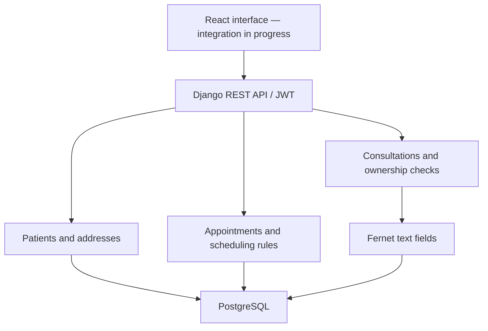

# Psychological Office

**Patient records, appointment scheduling, and consultation notes for a psychology practice.**

A full-stack prototype that models the workflow between reception staff and healthcare professionals: register a patient, reserve an appointment, and record the consultation. The backend contains the main business rules; the React interface is under development.

**Python · Django REST Framework · PostgreSQL · React 19 · JWT · Fernet**

[Product workflow](#product-workflow) · [Code walkthrough](#code-walkthrough) · [Run locally](#run-locally) · [API example](#try-the-api) · [Tests](#testing) · [Current limitations](#current-limitations)

> **Project status:** development prototype for portfolio review. The browser workflow still needs end-to-end validation. Use the API as the starting point for evaluation, with synthetic data only. No hosted demo or production-readiness claim is provided.

## Product workflow

A psychology practice needs to connect administrative work with clinical records while distinguishing who can perform each operation. This project explores that separation through explicit roles, scheduling rules, and consultation ownership.

| Step | Capability implemented in the backend | Relevant rule |
| --- | --- | --- |
| Register a patient | Contact details, residential and optional billing addresses, search, and WhatsApp link generation | CPF is preserved during updates |
| Schedule an appointment | Date, time, status, and optional residential-address updates | Appointment start times must be between 08:00 and 17:00 inclusive; each date/time pair is unique |
| Record a consultation | Current notes, previous notes, and attention points | Creation requires a healthcare-professional role and an eligible appointment |
| Complete the visit | Save consultation notes and complete the appointment | Both operations run inside a database transaction |

The schedule currently represents **one shared calendar**, not independent calendars per professional. Date/time uniqueness prevents identical start times; it does not model appointment duration or overlapping intervals.

### Roles

The code and API use Portuguese domain names; this documentation uses English descriptions.

| API role | Intended workflow and current behavior |
| --- | --- |
| `SECRETARIA` | Reception: patient records and appointments. Consultation access is denied (HTTP 403). |
| `PROFISSIONAL_SAUDE` | Patient records, appointments, and consultations. Consultation queries are filtered to the responsible professional. |
| `ADMIN` | Administrative role. It does not automatically bypass the patient/appointment role checks. |

These are application roles, separate from Django's `is_staff` and `is_superuser` flags. User registration and user-management endpoints require `ADMIN`; `/api/usuarios/me/` returns the authenticated account. Historical consultation notes are restricted to the same responsible professional.

## Code walkthrough

For a technical review, these are useful entry points:

| Engineering concern | Implementation | Why it matters |
| --- | --- | --- |
| Domain validation | [Appointment serializer](backend/agendamentos/serializers.py) and [model](backend/agendamentos/models.py) | Combines API validation with database uniqueness constraints |
| Consistent writes | [Patient serializer](backend/pacientes/serializers.py) and [consultation serializer](backend/consultas/serializers.py) | Uses atomic transactions for related changes |
| Authentication and authorization | [JWT configuration](backend/core/settings.py), [role permissions](backend/usuarios/permissions.py), and [consultation queryset](backend/consultas/views.py) | Separates identity, role checks, and record ownership |
| Encrypted persistence | [EncryptedTextField](backend/core/fields.py) | Encrypts text on persistence and decrypts when loading it; this is not end-to-end encryption |
| Change attribution | [Patient views](backend/pacientes/views.py) and serializers | Records creation/update users and timestamps, not a complete audit history |
| API documentation | [URL configuration](backend/core/urls.py) | Exposes an OpenAPI schema and Swagger UI |
| Automated verification | [Patient](backend/pacientes/tests.py), [appointment](backend/agendamentos/tests.py), [consultation](backend/consultas/tests.py), and [user](backend/usuarios/tests.py) tests | Exercises domain behavior and access scenarios; 30 tests pass with isolated SQLite settings |

### Architecture

The backend is a modular Django application. Domain modules share one PostgreSQL database; serializers handle validation and several business operations. The frontend uses React Router, an authentication context, and an Axios client.



| Directory | Responsibility |
| --- | --- |
| `backend/core/` | Settings, API routes, and encrypted text field |
| `backend/usuarios/` | Users, roles, registration, and permissions |
| `backend/pacientes/` | Patient identity, contact information, and addresses |
| `backend/agendamentos/` | Shared appointment calendar |
| `backend/consultas/` | Consultation records and completion workflow |
| `frontend/src/pages/` | Login, dashboard, patient, appointment, and consultation screens |
| `frontend/src/contexts/` and `services/` | Browser authentication state and HTTP access |

**Design trade-offs:** a shared calendar keeps scheduling simple but limits multi-professional use. A custom encrypted field keeps encryption out of individual views but depends on reliable key management. Business rules in serializers are easy to trace here; a larger application may benefit from extracting operations shared by multiple entry points.

## Run locally

The instructions below are derived from the source, not a verified clean-install run. Backend dependencies are not pinned, so reproducibility still needs improvement.

### Prerequisites

- Python compatible with the installed Django version; the settings reference Django 5.2.
- PostgreSQL running locally, with an empty database and a dedicated database user.
- Node.js and npm compatible with Vite 6, if exploring the frontend.
- Git.

### 1. Install backend dependencies

```bash
git clone https://github.com/joaovitormessias/psychological_office.git
cd psychological_office/backend
python -m venv .venv
source .venv/bin/activate
python -m pip install -r requirements.txt
```

On Windows PowerShell, activate with `.venv\Scripts\Activate.ps1`.

The requirements include `python-decouple` and `django-cors-headers`, which settings import.

### 2. Configure the environment

Create a local `backend/.env` file with the following names and your own values. Do not commit it.

```dotenv
DJANGO_SECRET_KEY=replace-with-a-generated-secret
DJANGO_FERNET_KEY=replace-with-a-generated-fernet-key
DB_NAME=psychological_office
DB_USER=psychological_office
DB_PASSWORD=replace-with-your-local-database-password
DB_HOST=127.0.0.1
DB_PORT=5432
```

Generate the two keys inside the activated virtual environment:

```bash
python -c "from django.core.management.utils import get_random_secret_key; print(get_random_secret_key())"
python -c "from cryptography.fernet import Fernet; print(Fernet.generate_key().decode())"
```

Keep the Fernet key stable for the lifetime of the encrypted records. Replacing it without migrating the data makes existing notes unreadable.

### 3. Initialize and start the API

After creating the PostgreSQL database and granting the configured user access:

```bash
python manage.py check
python manage.py migrate
python manage.py createsuperuser
python manage.py runserver
```

- API base: http://localhost:8000/api/
- Swagger UI: http://localhost:8000/swagger/
- OpenAPI schema: http://localhost:8000/api/schema/
- Django admin: http://localhost:8000/admin/

Use Django admin to create a synthetic reception or healthcare-professional account and set its `role`. The default `ADMIN` role is not sufficient for patient and appointment operations.

### 4. Explore the frontend source

In another terminal, from the repository root:

```bash
cd frontend
npm ci
npm run dev
```

The Axios client points to `http://localhost:8000/api`. The intended Vite URL is http://localhost:5173. The router now wraps the authentication provider, current-user lookup uses `/usuarios/me/`, and the patient form includes the required address. The frontend production build passes; the complete browser journey still needs validation.

## Try the API

Use Swagger UI for the initial walkthrough. Payload names and status values remain in Portuguese to match the implementation.

1. Call `POST /api/token/` with the username and password of your local demo account.
2. Use the returned access token as `Authorization: Bearer <access-token>` on protected requests.
3. As reception staff or a healthcare professional, call `POST /api/pacientes/` with synthetic data:

```json
{
  "nome": "Demo Patient",
  "cpf": "111.111.111-11",
  "nascimento": "1990-01-01",
  "celular": "11999999999",
  "email": "demo.patient@example.com",
  "endereco_residencial": {
    "cep": "01001-000",
    "uf": "SP",
    "cidade": "Demo City",
    "logradouro": "Demo Street",
    "numero": "100",
    "bairro": "Demo District"
  }
}
```

This deliberately synthetic CPF is for local demonstration only; the current validator does not enforce a checksum.

4. Use the returned patient ID in `POST /api/agendamentos/`:

```json
{
  "paciente_id": 1,
  "data": "2027-01-15",
  "hora": "10:00:00"
}
```

Replace `1` with the actual ID and choose a suitable date. Repeating the same date/time should produce a validation error.

5. Authenticate as a healthcare professional and call `POST /api/consultas/` using the returned appointment ID:

```json
{
  "agendamento_id": 1,
  "anotacoes_atuais": "Synthetic consultation notes for a local demonstration.",
  "pontos_atencao": "Demo only.",
  "concluir_consulta": true
}
```

The expected result is a consultation linked to that professional and an appointment with status `CONCLUIDO`. These are expected behaviors from source inspection, not a recorded end-to-end test result.

## Testing

With the backend environment configured and PostgreSQL available:

```bash
cd backend
python manage.py test usuarios pacientes agendamentos consultas
```

Django creates a separate test database; the configured PostgreSQL user needs permission to create it. For isolated domain tests without PostgreSQL, use `python manage.py test usuarios pacientes agendamentos consultas --settings=core.test_settings`. This dedicated configuration uses an in-memory SQLite database and test-only keys/password hashing; never use it to serve the application.

Frontend checks:

```bash
cd frontend
npm run build
npm run lint
```

There is no frontend test script in `package.json`. A successful production build alone would not verify authentication or the complete user journey.

**Verification status:** 30 backend tests passed with Python 3.12, Django 5.2.8 and isolated SQLite settings; the frontend production build and lint passed. Lint retains six React Hooks/Fast Refresh warnings. PostgreSQL-specific behavior and browser end-to-end flows are not claimed as verified. No coverage percentage is claimed.

## Current limitations

This project demonstrates backend implementation work, but several items remain before a dependable product demonstration:

- **Browser verification:** corrected authentication wiring, current-user lookup and nested address payloads still need a full browser acceptance test, including token expiry.
- **Access policy scope:** registration/user management are admin-only; consultation history follows professional ownership. Shared clinical records would require a separate explicit policy, not broader queries.
- **Development security settings:** debug mode and permissive CORS are enabled; a public fallback encryption key exists; access tokens last seven days and are stored in browser local storage. This configuration is not suitable for real patient data.
- **Validation and scheduling:** CPF/CEP validation is permissive, address lookup contains mock behavior, and appointments have no duration or per-professional calendar.
- **Reproducibility:** backend dependencies are unpinned. The isolated test environment does not replace a PostgreSQL deployment check.

### Next milestones

1. Validate the complete browser workflow with synthetic data and expired tokens.
2. Harden secrets, CORS and token lifetime before any real patient data.
3. Pin dependencies and add PostgreSQL integration checks.
4. Publish real demo screenshots and continuous integration after acceptance testing.

## Maintainer

[João Vitor Messias da Cruz Damasio](https://github.com/joaovitormessias)

For questions or reproducible bugs, [open an issue](https://github.com/joaovitormessias/psychological_office/issues).

No license file is currently included; this README does not grant an additional software license.
